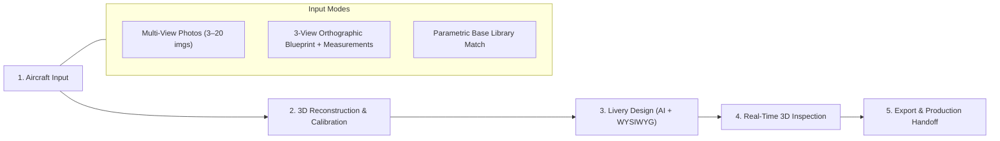
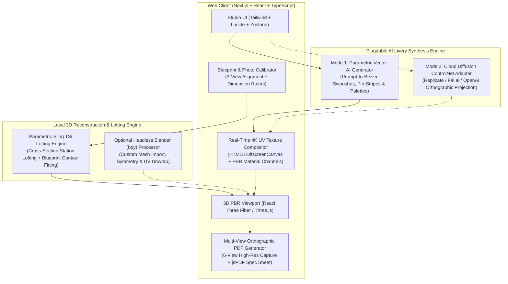
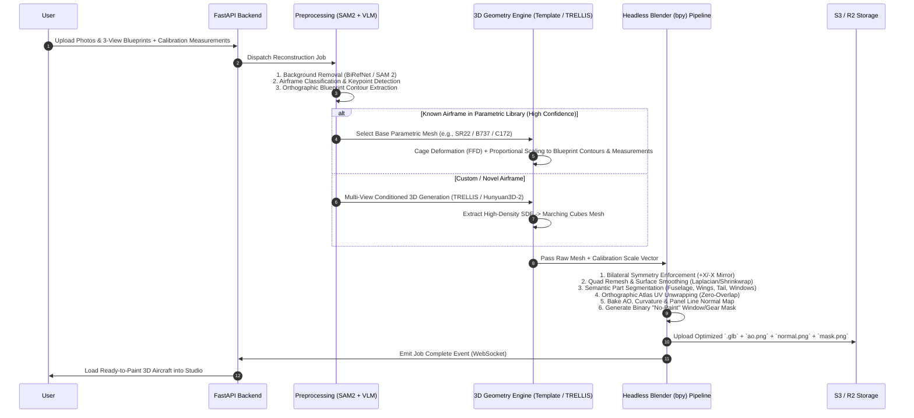
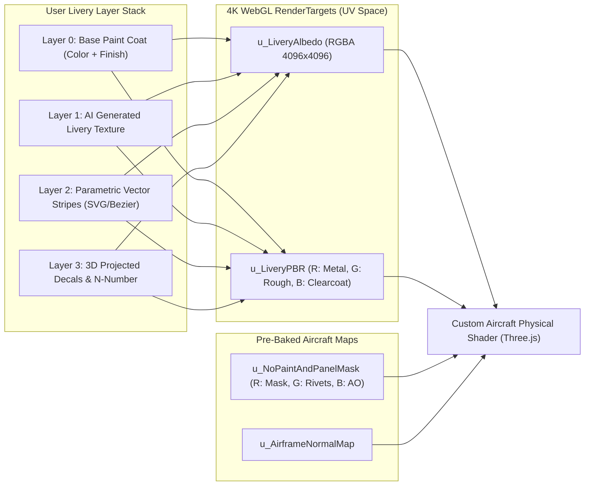
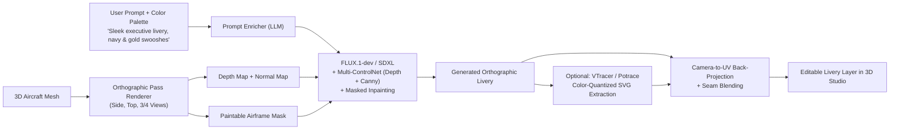
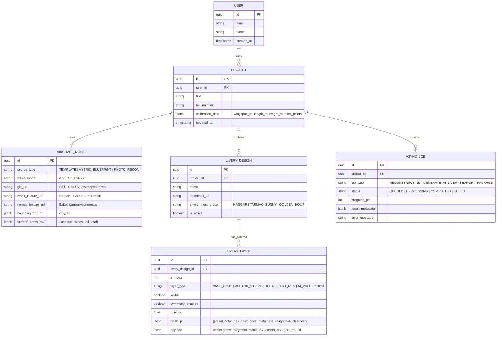

# Product Requirements Document (PRD) & Technical Design Document (TDD)
## Project: AeroCanvas — 3D Aircraft Reconstruction & Livery Design Studio

---

## Part 1: Product Requirements Document (PRD)

### 1.1 Executive Summary & Vision
**AeroCanvas** is a web-based 3D aircraft reconstruction and paint scheme (livery) customization studio, focused initially on **General Aviation (GA)** with the **Sling TSi** (4-place low-wing experimental/kit aircraft) as the primary reference airframe. It enables builders, owners, and aviation paint shops to generate a dimensionally accurate, UV-unwrapped 3D model of the aircraft from realistic photographs and/or 3-view technical drawings (POH/KIT blueprints with measurements), customize its paint scheme in real time using **AI Generative Prompts** or a **WYSIWYG 3D/2D Vector & Decal Studio**, preview it on the web (Phase 1), and export precision **paint masking & stencil artifacts** for physical painting (Phase 2).

### 1.1.1 Reference Airframe Profile: Sling TSi
| Parameter | Specification | Impact on 3D & Paint Engine |
| :--- | :--- | :--- |
| **Configuration** | Low-wing, single-engine tractor (3-blade constant-speed prop), fixed tricycle gear with wheel pants (spats) | Wheel pants (nose + main gear fairings) are critical livery surfaces that must carry matching accent stripes. |
| **Dimensions** | **Wingspan**: `9.53 m` (`31.27 ft`)<br/>**Length**: `7.175 m` (`23.54 ft`)<br/>**Height**: `2.45 m` (`8.04 ft`) | Used as default calibration constraints for blueprint & photo scaling. |
| **Surface Construction** | Flush-riveted Alclad aluminum skins + composite cowling, canopy frame, wingtips, and wheel fairings | Requires high-gloss/metallic PBR shaders with subtle panel-seam maps and distinct composite vs. aluminum zones. |
| **Protected Zones** | Bubble canopy glass, propeller blades/spinner (optional chrome/paint), NACA ducts, exhaust pipe, landing gear struts/tires | Must be masked out (`u_NoPaintMask`) so paint and AI prompts only apply to paintable skin and wheel fairings. |

### 1.2 Target Personas & Use Cases

| Persona | Primary Goal | Key Pain Points Solved |
| :--- | :--- | :--- |
| **Private Aircraft Owner / Buyer** (General Aviation, Turboprops, Business Jets) | Visualize custom paint schemes on their specific aircraft (e.g., Cirrus SR22, Cessna 172, Gulfstream G650) before spending $30k–$250k+ at a paint shop. | Existing tools are 2D side-profile sketches; hard to judge how swooshes wrap around compound curves (wing roots, nacelles, empennage). |
| **Aviation Paint & Refurbishment Shop** | Rapidly iterate with clients during consultation, generate dimensionally accurate masking/stencil guides, and estimate paint volume per surface area. | Manual 3D modeling per aircraft takes days; back-and-forth PDF proofs delay sign-off by weeks. |
| **Livery Designer / Concept Artist** | Prototype dozens of livery concepts in minutes via AI prompts, then refine vector stripes, registration numbers, and metallic finishes in 3D. | Unwrapping 3D aircraft models and aligning 2D UV seams across fuselage/tail joints is tedious. |
| **Flight Sim & RC Scale Modeler** | Generate custom liveries and export ready-to-use 4K/8K PBR texture maps or 3D printable/decal sheets. | Steep learning curve of Blender/Substance Painter for non-3D specialists. |

---

### 1.3 User Journey & Core Workflows



1. **Project Initialization & Aircraft Ingestion**:
   - User creates a project and selects an input mode:
     - **Mode A (Photo + Blueprint Hybrid)**: Upload 3-view orthographic schematics (Top, Side, Front) + key dimensions (wingspan, overall length, tail height) + optional reference photos.
     - **Mode B (Photo-Only Reconstruction)**: Upload 4–20 walkaround photos of an airplane; the system identifies the airframe or reconstructs geometry via multi-view AI + template fitting.
     - **Mode C (Base Template Library)**: Pick a pre-rigged airframe (e.g., Cessna 172, Beechcraft Bonanza, Pilatus PC-12, Boeing 737-800) and optionally tweak dimensions/winglets/radome mods.
2. **Mesh Segmentation & Paint Mask Verification**:
   - The system segments the aircraft into paintable vs. non-paintable zones:
     - **Paintable Zones**: Fuselage, Vertical Stabilizer, Rudder, Horizontal Stabilizers, Main Wings, Winglets, Engine Cowlings/Nacelles, Gear Doors, Spinner/Radome.
     - **Protected Masks (Non-Paint)**: Windshield/Cabin Windows, De-icing Boots, Chrome Propellers/Exhausts, Pitot/Static Ports, Landing Gear Struts, Antennae.
3. **Livery Design & Customization**:
   - **AI Livery Co-Pilot**: Prompt-based full livery generation or regional style transfer (e.g., *"Sleek Titanium Silver base with deep crimson and carbon-fiber swept accent lines from nose cone to vertical stabilizer"*).
   - **WYSIWYG 3D/2D Studio**:
     - Zone Fill (assign aviation paint colors/finishes per airframe part).
     - Parametric Vector Stripes / Swooshes (editable Bezier curves projected onto the fuselage/wings without UV seam distortion).
     - Decal & Registration Tool (tail numbers with regulatory sizing checks, airline/corporate logos, warning stencils).
     - PBR Material & Finish Controls (Gloss Clearcoat, Satin/Matte, Metallic Flake, Pearlescent, Anodized Trim).
4. **3D Inspection & Environment Preview**:
   - Orbit/First-person walkaround camera in interactive HDRI environments (Hangar studio lighting, Sunny Tarmac, Golden Hour Flight, Overcast).
   - Surface area and paint estimate calculator based on real-world dimensions.
5. **Export & Handoff**:
   - Interactive share link, `.glb` / `.usdz` (iOS AR walkaround), 4K/8K UV texture packs (`.png`), and Shop Spec PDF (orthographic 4-view dimension callouts + paint code BOM).

---

### 1.4 Functional Requirements

#### FR-1: Aircraft Input & Calibration
| ID | Requirement | Priority |
| :--- | :--- | :--- |
| **FR-1.1** | Support uploading up to 20 photos (`.jpg`, `.png`, `.webp`, `.heic`) and 3-view drawings (`.pdf`, `.svg`, `.png`). | P0 |
| **FR-1.2** | Provide an interactive **2-Point / 3-Axis Calibration Ruler** on uploaded blueprints/photos so users can input real-world measurements (e.g., Wingspan = `11.00 m`, Length = `8.28 m`). | P0 |
| **FR-1.3** | Automatically remove background clutter (tarmac, hangar, sky) from uploaded aircraft photos using segmentation (`SAM 2` / `rembg`). | P0 |
| **FR-1.4** | Classify the uploaded aircraft make/model (e.g., via VLM/CLIP) and suggest matching high-precision parametric base meshes when available, or run full custom 3D reconstruction. | P1 |

#### FR-2: 3D Reconstruction & Mesh Preparation
| ID | Requirement | Priority |
| :--- | :--- | :--- |
| **FR-2.1** | Generate a watertight, bilaterally symmetric 3D mesh scaled to metric/imperial physical dimensions. | P0 |
| **FR-2.2** | Automatically enforce **bilateral symmetry** along the longitudinal (roll) axis unless asymmetric airframe configuration is toggled. | P0 |
| **FR-2.3** | Perform automated semantic segmentation and UV unwrapping into standardized islands (`fuselage_left`, `fuselage_right`, `tail_left`, `tail_right`, `wing_top_L`, `wing_top_R`, `wing_bottom_L`, `wing_bottom_R`, `nacelles`). | P0 |
| **FR-2.4** | Bake an **Ambient Occlusion (AO) & Panel Line/Rivet Normal Map** so custom paint automatically retains underlying panel seams, rivets, and control surface gaps. | P0 |
| **FR-2.5** | Generate a binary **No-Paint Mask** protecting windows, tires, props, and de-ice boots from livery paint bleed. | P0 |

#### FR-3: WYSIWYG Livery Studio
| ID | Requirement | Priority |
| :--- | :--- | :--- |
| **FR-3.1** | **Layer Stack System**: Support unlimited ordered layers (Base Coat, Vector Stripes, AI Texture Layer, Decals, Registration Text, Weathering/Pin-striping) with blend modes and opacity. | P0 |
| **FR-3.2** | **3D Bezier Ribbon / Stripe Tool**: Allow users to place control points directly on the 3D fuselage or side-profile orthographic viewport to draw smooth aerodynamic swooshes and stripes with adjustable width, taper, and pinstripe offsets. | P0 |
| **FR-3.3** | **Symmetry Mirroring**: One-click mirroring of decals and stripes from Port (Left) to Starboard (Right) side, automatically keeping text readable (non-reversed) while mirroring graphic geometry. | P0 |
| **FR-3.4** | **Tail Number / Registration Generator**: Built-in aviation typography presets (US FAA 12-inch regulation slant/block fonts, EASA, civilian custom fonts) with real-time physical height readout (inches/cm) on the mesh. | P0 |
| **FR-3.5** | **Aviation Paint Library**: Pre-loaded catalog of industry-standard aviation paint swatches (e.g., Sherwin-Williams Aerospace, Mankiewicz, AkzoNobel — Matterhorn White, Daytona Yellow, Metallic Titanium, Pearlescent Midnight Blue) with physically accurate PBR parameters. | P1 |
| **FR-3.6** | **Synchronized 2D UV & 3D Viewport**: Split-screen mode allowing direct editing on the 2D orthographic/UV template alongside the live 3D PBR viewport. | P1 |

#### FR-4: AI Generative Livery Engine
| ID | Requirement | Priority |
| :--- | :--- | :--- |
| **FR-4.1** | **Text-to-Livery Generation**: Generate complete or partial paint schemes from natural language prompts + optional style reference image. | P0 |
| **FR-4.2** | **Geometry-Aware Conditioning**: Constrain AI generation using the aircraft's orthographic depth, normal, and no-paint window masks so swooshes follow the fuselage contour and never paint over windows. | P0 |
| **FR-4.3** | **Regional Inpainting / Mask Prompting**: Allow users to lasso or select a specific zone (e.g., Vertical Stabilizer only) and prompt AI exclusively for that region. | P1 |
| **FR-4.4** | **Raster-to-Vector Livery Extraction**: Vectorize AI-generated concepts into clean, sharp SVG paths/layers so edges remain crisp at any zoom level and can be tweaked in the WYSIWYG editor. | P1 |

#### FR-5: Export & Production Output (Phased)
| ID | Requirement | Phase | Priority |
| :--- | :--- | :---: | :--- |
| **FR-5.1** | **Interactive 3D Web Preview**: Real-time orbit/walkaround inspection with lighting presets, toggleable symmetry, and shareable project state. | Phase 1 | P0 |
| **FR-5.2** | **2D Multi-View Rendering Export to PDF**: Generate a clean, high-resolution PDF proof sheet directly from the 3D scene containing orthographic 2D renders (**Left Profile, Right Profile, Top View, Bottom View, Front View**) plus a **3/4 Perspective Hero Render**, aircraft tail number, and a **Paint Color & Finish Swatch Legend**. | Phase 1 | P0 |
| **FR-5.3** | **Physical Paint Masking & Stencil Artifacts**: Export paint-shop-ready masking deliverables:<br/>• **Dimensioned Masking Blueprint PDF**: Orthographic views with datum-referenced offset measurements (distance from firewall datum, wing root, leading edge, or fuselage longeron/panel seam to stripe control points in inches/mm).<br/>• **1:1 Scale Vector Stencils (`.svg` / `.dxf`)**: Unwrapped flat patterns for N-numbers, logos, and complex nose/tail curves ready for a vinyl plotter/mask cutter. | Phase 2 | P0 |
| **FR-5.4** | Export standalone `.glb` / `.usdz` (AR walkaround on iPad/iPhone next to the physical aircraft in the hangar) and 4K/8K UV texture packs. | Phase 2 | P1 |

---

### 1.5 Non-Functional Requirements (NFRs)
* **Rendering Performance**: Maintain **60 FPS** in the browser on mid-range laptops (Apple M1 / integrated GPUs) while editing 4K composite textures in real time.
* **Texture Resolution**: Support 4096×4096 (4K) working resolution in WebGL/WebGPU and 8192×8192 (8K) offline export.
* **3D Reconstruction Latency**:
  * Template-fitted reconstruction: `< 15 seconds`.
  * Full multi-view AI mesh reconstruction + retopology + UV unwrap: `< 90 seconds`.
* **AI Livery Synthesis Latency**: `< 12 seconds` per 4-concept batch generation.
* **Dimensional Accuracy**: Scaled mesh measurements and stripe/registration heights must be accurate within **$\pm 1.5\%$** of user-supplied calibration dimensions.

---
---

## Part 2: Technical Design Document (TDD)

### 2.1 System Architecture Overview (Finalized Compute Strategy)

Based on architectural alignment, the system uses a **Local-First Parametric 3D Engine** (zero-cost, mathematically smooth aircraft surfaces ideal for high-gloss reflections and Phase 2 physical masking) paired with a **Dual-Mode Pluggable AI Livery Engine** (combining instant LLM/Procedural Vector Livery synthesis with optional Cloud Diffusion ControlNet APIs).



---

### 2.2 Pipeline A: Photo & Blueprint to 3D Model Reconstruction

Reconstructing aircraft for livery painting is fundamentally different from generic photogrammetry: **aircraft surfaces must be smooth, bilaterally symmetric, segmented into semantic parts, and cleanly UV-unwrapped**. Bumpy photogrammetry meshes ruin glossy clearcoat reflections and make straight pinstripe projection impossible.



#### Step-by-Step Reconstruction Mechanics

1. **Image & Blueprint Preprocessing**:
   * **Photos**: Run `BiRefNet` or `SAM 2` to isolate the aircraft with clean alpha masks and estimate camera poses (`DUSt3R` / `MASt3R`).
   * **3-View Drawings / Blueprints**: Extract orthographic silhouettes (Top, Side, Front) using adaptive thresholding and Canny/HED edge detection. Apply the user's calibration ruler ratio ($\text{pixels-per-meter}$) to establish an exact 3D bounding box $(L \times W \times H)$ in meters.

2. **Dual-Path Geometry Synthesis**:
   * **Path 1 — Parametric Cage Fitting (Preferred when airframe category matches)**:
     * Maintain a curated library of 15–20 topological archetypes (High-Wing Single Prop, Low-Wing Single Prop, Twin Piston, Single Turboprop, Twin Turboprop, Light Business Jet, Heavy Business Jet, Narrow-Body Airliner, Wide-Body Airliner, Canard, Taildragger).
     * Use **Free-Form Deformation (FFD)** and non-rigid ICP (Iterative Closest Point) against the extracted 3-view blueprint silhouettes and user measurements $(L, W, H, \text{wing sweep}, \text{dihedral})$ to morph the clean base mesh to the exact target proportions.
   * **Path 2 — Generative Multi-View 3D Reconstruction (For novel/custom aircraft)**:
     * Feed background-stripped photos and orthographic views into **Microsoft TRELLIS** or **Hunyuan3D-2** (multi-view conditioned sparse 3D transformer).
     * Extract the signed distance field (SDF) and convert to mesh.

3. **Headless Blender (`bpy`) Post-Processing & UV Standardization**:
   A Python script running inside a headless Blender 4.x container executes deterministic geometry normalization:
   * **Symmetry & Alignment**: Center pivot at the aircraft Center of Gravity (CG), align nose to $+Y$ (or $+Z$), enforce bilateral symmetry via `bpy.ops.mesh.symmetrize()`, and scale vertices to exact metric dimensions.
   * **Aviation-Specific UV Unwrapping**:
     Instead of chaotic automatic UV islands, `bpy` performs **Orthographic Projection Unwrapping** aligned with how livery artists work:
     ```
     +---------------------------------------------------+
     |  FUSELAGE + TAIL (LEFT)   (0.0, 0.75) - (1.0, 1.0)|
     +---------------------------------------------------+
     |  FUSELAGE + TAIL (RIGHT)  (0.0, 0.50) - (1.0, 0.75)|
     +-------------------------+-------------------------+
     |  WINGS & STAB (TOP)     |  WINGS & STAB (BOTTOM)  |
     |  (0.0, 0.15)-(0.5, 0.50)|  (0.5, 0.15)-(1.0, 0.50)|
     +-------------------------+-------------------------+
     |  NACELLES / COWL / MISC   (0.0, 0.00) - (1.0, 0.15)|
     +---------------------------------------------------+
     ```
   * **Mask & Map Baking**:
     * `mask_nopaint.png`: `R` = Paintable Airframe (`1.0` = paintable, `0.0` = protected glass/tires/props), `G` = Panel Line/Rivet groove depth, `B` = Ambient Occlusion.

---

### 2.3 Pipeline B: Real-Time GPU Livery Compositing & Shader Architecture

To achieve 60 FPS while editing stripes, decals, metallic flakes, and clearcoat finishes, the frontend uses a **Two-Stage GPU Pipeline**:
1. **Dynamic 2D Atlas Compositor** (renders user layers into 4K PBR texture targets: `AlbedoMap`, `MetalRoughnessMap`, `ClearcoatMap`).
2. **Aircraft Surface Shader (`MeshPhysicalMaterial` + Custom Shader Chunk)** in Three.js.

#### 2.3.1 Layer Stack to PBR Atlas Compositing



#### 2.3.2 Aviation Paint Finishes (PBR Presets)
Each layer or vector stripe isn't just an RGB color—it carries an **Aviation Material Finish** preset that writes to both `u_LiveryAlbedo` and `u_LiveryPBR`:

| Finish Preset | Metalness | Roughness | Clearcoat | Clearcoat Roughness | Visual Effect |
| :--- | :---: | :---: | :---: | :---: | :--- |
| **Aviation High-Gloss Polyurethane** (e.g., Matterhorn White) | `0.00` | `0.12` | `1.00` | `0.04` | Deep mirror-like clearcoat over non-metallic pigment |
| **Metallic Basecoat / Clearcoat** (e.g., Titanium Silver, Champagne Gold) | `0.85` | `0.22` | `1.00` | `0.05` | Anisotropic metallic sparkle underneath wet-look clearcoat |
| **Pearlescent / Mica** | `0.45` | `0.18` | `1.00` | `0.03` | Subtle view-angle iridescence + gloss |
| **Tactical / Stealth Matte** | `0.05` | `0.75` | `0.00` | `0.80` | Diffused flat finish, zero specular clearcoat |
| **Polished Bare Aluminum / Chrome Spinner** | `1.00` | `0.05` | `0.20` | `0.05` | Mirror metallic reflection |

#### 2.3.3 Custom GLSL Fragment Injection (`onBeforeCompile`)
In Three.js, we extend `MeshPhysicalMaterial` so that regardless of what the user paints or projects via AI, **windows remain glass, de-icing boots remain matte black rubber, and panel lines/rivets always show through the paint**:

```glsl
// Injected into MeshPhysicalMaterial fragment shader
uniform sampler2D u_NoPaintAndPanelMask; // R: PaintableMask, G: PanelLines, B: BakedAO
uniform vec3 u_ProtectedSurfaceColor;

// 1. Sample masks
vec4 airframeMask = texture2D(u_NoPaintAndPanelMask, vUv);
float paintable = airframeMask.r;     // 1.0 on airframe, 0.0 on windows/tires/props
float panelGroove = airframeMask.g;   // 1.0 on flat skin, 0.2 inside panel seams/rivets
float bakedAO = airframeMask.b;

// 2. Blend livery paint only onto paintable regions
diffuseColor.rgb = mix(u_ProtectedSurfaceColor, diffuseColor.rgb, paintable);

// 3. Modulate panel lines & rivets subtly into paint & clearcoat
diffuseColor.rgb *= mix(0.65, 1.0, panelGroove) * bakedAO;
roughnessFactor = mix(0.6, roughnessFactor, panelGroove); // Panel seams are less glossy
clearcoat *= paintable * step(0.5, panelGroove);          // No clearcoat inside panel gaps or on tires
```

---

### 2.4 Pipeline C: WYSIWYG 3D Vector Stripes & Decal Projection

Drawing smooth, sweeping curves on a 3D airplane is notoriously tricky if done purely in 2D UV space because UV islands have seams between the fuselage, wing roots, and tail fin. AeroCanvas solves this via **3D View-Plane Projection + Decal Geometry**:

1. **Interactive 3D Bezier Stripe Tool**:
   * The user clicks control points $\mathbf{P}_0, \mathbf{P}_1, \mathbf{P}_2, \mathbf{P}_3$ directly on the 3D aircraft surface (via Raycasting) or in the Side-Profile Camera mode.
   * Each control point has handles for curvature, **stripe width ($w_i$)**, and **pinstripe offset ($o_i$)** (enabling classic aviation tapered swooshes with a thin secondary accent line).
   * An orthographic projection matrix aligned with the stroke plane renders the vector curve directly into the UV space render target via a UV-space unwrap pass (rendering the mesh in UV coordinates `[vUv.x * 2.0 - 1.0, vUv.y * 2.0 - 1.0, 0.0]` while projecting the 2D Bezier texture from the stroke camera matrix).
   * **Result**: Zero seam distortion across fuselage-to-tail or fuselage-to-cowling boundaries!

2. **Symmetry & Readable Registration Mirroring**:
   * When `Symmetry = ON`, every stripe projection matrix $\mathbf{M}_{\text{left}}$ automatically spawns a mirrored projection $\mathbf{M}_{\text{right}} = \mathbf{S}_x \cdot \mathbf{M}_{\text{left}}$.
   * For **Registration Numbers (N-Numbers)** and text decals:
     * **Position and slant angle** are mirrored across the $X$-axis (so an italic slant leaning toward the tail on the left side also leans toward the tail on the right side).
     * **Glyph horizontal flip is inverted** so the text reads Left-to-Right (`N742AC`) on both sides of the fuselage/tail.
   * **Physical Dimension Badge**: Because the 3D mesh is calibrated in meters, the bounding box of the registration decal in 3D world space is continuously measured (`height_meters * 39.3701 = inches`). A live badge shows `Height: 12.2 in (FAA Compliant >= 12.0 in)`.

---

### 2.5 Pipeline D: AI Generative Livery Engine



1. **Multi-Conditioned Orthographic Generation**:
   * Generating raw 2D UV textures directly with Stable Diffusion/FLUX fails because diffusion models do not understand arbitrary UV island layouts.
   * Instead, we render clean **Side Profile** and **Top-Down** orthographic passes of the aircraft's **Depth Map**, **Normal Map**, and **Paintable Silhouette Mask**.
   * We run **FLUX.1-dev** (or **SDXL**) conditioned on:
     * `ControlNet-Depth` & `ControlNet-Normal` (weight `0.75`) to ensure swooshes wrap naturally around the nose cone, cockpit curvature, and vertical stabilizer.
     * `Inpaint Mask` derived from `mask_nopaint.png` so the AI strictly paints the airframe and leaves background, windows, and propellers untouched.
     * `IP-Adapter` (optional) if the user uploads a reference livery photo or corporate brand guideline.
2. **Back-Projection & Optional Vectorization**:
   * **Raster Mode**: The generated high-res orthographic views are projected onto the 3D mesh's UV atlas using normal-weighted triplanar blending (`dot(surfaceNormal, projectionDir)`), smoothly blending the Side view with the Top/Bottom wing views.
   * **Vector Mode (Sharp Edges)**: Since aviation liveries consist of crisp geometric zones, an optional color-quantization + vectorization pass (`VTracer`) converts the AI raster output into clean, multi-layered SVG paths that the user can tweak node-by-node in the WYSIWYG editor.

---

### 2.6 Data Model & Database Schema (PostgreSQL)



---

### 2.7 API Specification (FastAPI REST + WebSockets)

#### 1. Aircraft Ingestion & 3D Reconstruction
* `POST /api/v1/projects/{id}/reconstruct`
  * **Request Body**:
    ```json
    {
      "mode": "HYBRID_BLUEPRINT",
      "aircraft_hint": "Cessna 182 Skylane",
      "photos": ["s3://.../photo1.jpg", "s3://.../photo2.jpg"],
      "blueprints": {
        "side_url": "s3://.../side_drawing.png",
        "top_url": "s3://.../top_drawing.png",
        "front_url": "s3://.../front_drawing.png"
      },
      "calibration": {
        "wingspan_m": 11.0,
        "length_m": 8.84,
        "height_m": 2.84,
        "side_ruler_px": [{"x": 42, "y": 310}, {"x": 1980, "y": 310}]
      },
      "enforce_symmetry": true
    }
    ```
  * **Response**: `202 Accepted` `{ "job_id": "job_98a7c...", "ws_channel": "/ws/jobs/job_98a7c" }`

#### 2. AI Livery Generation
* `POST /api/v1/projects/{id}/livery/ai-generate`
  * **Request Body**:
    ```json
    {
      "prompt": "Modern executive jet livery, Matterhorn White base with sweeping midnight blue and champagne gold stripes along fuselage up to vertical tail",
      "negative_prompt": "rust, dirt, camouflage, blurry edges, text, numbers",
      "palette_hex": ["#F5F7FA", "#0F2547", "#D4AF37"],
      "target_zones": ["fuselage", "tail", "winglets"],
      "vectorize_output": true,
      "num_variations": 4
    }
    ```
  * **Response**: `202 Accepted` `{ "job_id": "job_ai_441b..." }`

#### 3. Production Export
* `POST /api/v1/projects/{id}/livery/{livery_id}/export`
  * **Request Body**:
    ```json
    {
      "formats": ["GLB_4K", "USDZ_AR", "UV_PACK_8K", "SHOP_SPEC_PDF"],
      "include_paint_bom": true
    }
    ```

---

### 2.8 Proposed Repository Directory Structure

```text
airplane_paint_schema/
├── apps/
│   ├── web/                          # Next.js 15 Frontend (TypeScript)
│   │   ├── src/
│   │   │   ├── app/                  # App Router pages (/studio/[projectId], /dashboard)
│   │   │   ├── components/
│   │   │   │   ├── canvas3d/         # React Three Fiber scene, AircraftMesh, DecalProjector
│   │   │   │   ├── editor2d/         # Synchronized 2D UV & Blueprint Calibration Ruler
│   │   │   │   ├── studio-ui/        # Layer stack, Aviation Swatch Picker, AI Prompt Bar
│   │   │   ├── engine/
│   │   │   │   ├── compositor/       # WebGL RenderTarget Atlas Compositor & GLSL Shaders
│   │   │   │   ├── bezier-projector/ # 3D Bezier curve to UV projection math
│   │   │   │   └── symmetry/         # Port/Starboard mirroring & N-Number glyph logic
│   │   │   └── store/                # Zustand state store (undo/redo history, layers)
│   │   └── public/
│   │       └── base-models/          # Curated starter parametric GLBs + HDRI environments
│   │
│   └── api/                          # FastAPI Backend (Python 3.12)
│       ├── app/
│       │   ├── api/v1/               # REST endpoints & WebSocket managers
│       │   ├── models/               # SQLAlchemy / Pydantic schemas
│       │   ├── services/             # S3 storage, PDF spec generator, area calculator
│       │   └── workers/              # Celery / Modal async task definitions
│       └── pipelines/
│           ├── reconstruction/       # SAM2, Blueprint contour fitter, TRELLIS client
│           ├── blender_scripts/      # Headless bpy: remesh, symmetry, UV unwrap, AO bake
│           └── ai_livery/            # FLUX/SDXL + ControlNet depth/normal + VTracer
├── packages/
│   └── shared-types/                 # Shared JSON schemas / TypeScript types for layers
├── docker-compose.yml                # Postgres, Redis, MinIO (local S3), API, Blender worker
└── docs/
    └── PRD_AND_DESIGN.md
```

---

### 2.9 Key Technical Risks & Mitigations

| Risk | Impact | Mitigation Strategy |
| :--- | :--- | :--- |
| **Raw image-to-3D meshes have lumpy surfaces & bad topology** | High — Glossy clearcoat paint looks wavy and distorted on uneven triangles. | Prioritize **Template-Assisted Cage Deformation (FFD)** for standard aircraft shapes, and run a mandatory headless Blender **Shrinkwrap + Laplacian Smooth + Bilateral Symmetry** pass on all AI-generated meshes. |
| **UV Seam Discontinuities when drawing stripes across fuselage/tail joints** | High — Stripes break or jump when crossing 2D UV island boundaries. | Do not draw stripes in 2D UV coordinates. Project stripes in **3D Camera/World Space** onto a UV-space render target (`gl_Position = vec4(uv * 2.0 - 1.0, 0.0, 1.0)`), making UV seams invisible to the user. |
| **AI Livery Generator paints over cockpit windshields or passenger windows** | Medium — Breaks realism and confuses paint masks. | Bake a deterministic binary `u_NoPaintMask` during mesh segmentation. Enforce this mask both in the ControlNet inpainting step and in the real-time Three.js fragment shader. |
| **Browser GPU memory exhaustion with multiple 4K layers** | Medium — Context loss on integrated GPUs. | Flatten non-active background layers into a single cached 4K `OffscreenCanvas` texture, keeping only the currently selected layer dynamic during drag/edit operations. |

---

### 2.10 Phased Implementation Roadmap

* **Phase 1: Sling TSi 3D Livery Studio, Blueprint-to-3D Calibration & 2D PDF Export**
  * **3D Ingestion & Sling TSi Model**: Build the 3-view blueprint + photo calibration pipeline and generate a dimensionally calibrated, UV-unwrapped **Sling TSi** 3D model (`9.53m` span × `7.175m` length × `2.45m` height, including wheel fairings, bubble canopy mask, and flush-riveted panel seams).
  * **Interactive Web 3D Preview**: Build the React Three Fiber studio with aviation PBR finishes (High-Gloss Polyurethane, Metallic Flake, Matte), 3D Bezier Stripe Projector, Symmetric Registration (N-Number) generator, and AI Livery Prompting.
  * **2D Multi-View PDF Export**: Implement one-click orthographic camera capture (Left, Right, Top, Bottom, Front + 3/4 Hero) rendered directly into a printable **PDF Livery Proof Sheet** with color swatch codes.
* **Phase 2: Precision Paint Masking & Stencil Artifacts**
  * **Datum-Referenced Masking Blueprint Generator**: Automatically compute and annotate physical tape-measure offsets from Sling TSi reference datums (firewall edge, canopy rail, wing leading edge, tail post, and panel rivet lines) to every stripe inflection point.
  * **1:1 Plotter Stencil Unwrapper (`.svg` / `.dxf`)**: Unwrap 3D surface decals, registration numbers, and complex curve masks into flat 1:1 scale vector patterns for vinyl cutters / paint mask plotters.
  * **General Aviation Expansion**: Expand parametric reconstruction templates to other popular GA aircraft (RV-10,RV-14, Cirrus SR22, Cessna 172/182).
